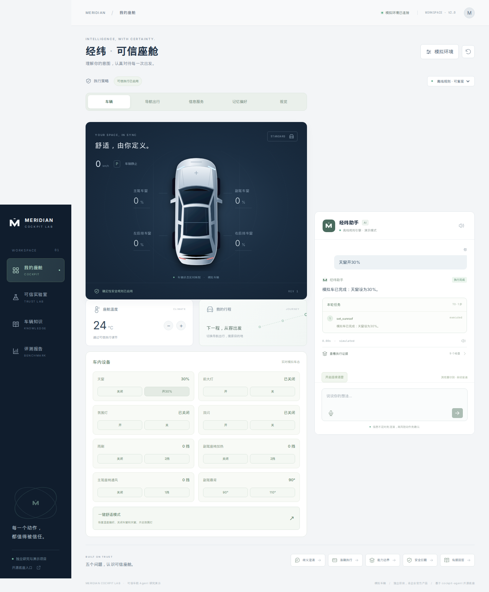
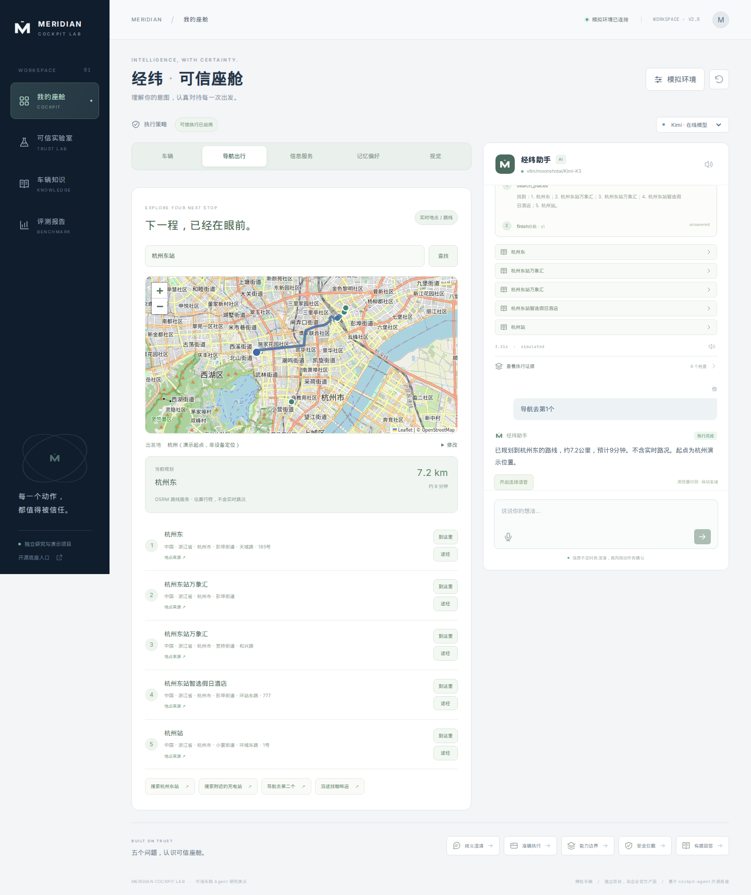
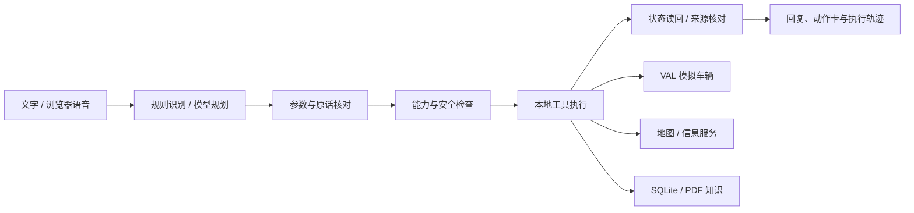

# 经纬 · 可信座舱

**一个可以运行、观察执行过程、复现实验的车载 AI Agent 演示项目。**

用户通过文字或语音提出需求，Agent 选择工具；确定性执行层检查参数、能力与安全条件，经模拟车辆执行后读回状态。项目同时提供导航、信息服务、记忆、手册检索与图片理解，用于展示从自然语言到可验证结果的完整链路。

基于 [SuperdeMan/cockpit-agent](https://github.com/SuperdeMan/cockpit-agent) 的 Apache-2.0 源码快照，新增独立工作台、可信执行机制与实验材料。**所有车辆动作均为模拟；本项目与经纬恒润公司无官方关联。**



## 能演示什么

| 功能 | 可以试的例子 | 实现与条件 |
|---|---|---|
| 车控与车辆动画 | “副驾车窗开50%” | React/SVG 展示分位置车态；工具经过 Schema、能力、安全检查与 VAL 模拟驱动 |
| 五类可靠性 | “帮我打开一点”、高速状态下要求开门 | 展示澄清、错位检出、能力拒绝、安全拦截与有来源的手册回答 |
| 导航出行 | “从杭州西湖到杭州东站，规划驾车路线” | Photon 地点检索、Overpass POI、OSRM 路线；需要外部服务网络，无实时交通 |
| 信息服务 | “杭州今天天气怎么样”“今天有什么新闻” | Open-Meteo、新闻 RSS 与网页检索；显示来源和缓存状态 |
| 偏好与提醒 | 保存空调偏好、创建本地提醒 | SQLite 持久化；本地单用户数据，提醒依赖应用运行 |
| 车辆知识 | 选定手册后问“胎压警告是什么意思” | PDF 按页解析、重叠切片、BM25 与中英术语扩展；返回页码和原文 |
| 语音与视觉 | 语音提问；上传一张仪表图片 | 浏览器语音识别/朗读；图片需要支持视觉的外部模型 |
| 多步骤任务 | 组合查询、候选选择与后续操作 | 本地规则或模型规划，工具结果反馈，执行预算与逐步证据 |



截图为已保存的演示记录，实时路线、新闻和模型结果可能不同。逐项操作与边界见 [功能演示手册](docs/06_扩展功能与演示路线.md)。

## 快速开始

需要 **Python 3.11+、Node.js 22+、npm**。以下命令适用于 Linux、macOS 或 WSL 的 Bash；从仓库根目录执行：

```bash
bash setup.sh
.venv/bin/python start.py
```

安装会创建虚拟环境、安装依赖并构建前端。访问 **http://127.0.0.1:8787**，API 文档为 **http://127.0.0.1:8787/docs**。端口冲突时使用 `start.py --port 8790`；远程服务器可用 IDE 转发 8787 端口。

不配置模型也可以启动，体验规则支持的明确车控和可靠性场景。复杂规划与图片理解需要模型；地图、天气、新闻等外部工具即使由规则触发也需要联网。依赖安装完成后，本地模拟车控与已导入的手册检索可以在没有这些外部服务的情况下运行。

### 配置模型

```bash
cp .env.example .env
```

在本地 `.env` 中填写：

```dotenv
COCKPIT_API_BASE=https://your-model-provider.example/v1
COCKPIT_API_KEY=replace-with-your-private-key
COCKPIT_MODEL=your-text-model-id
COCKPIT_VISION_MODEL=your-vision-model-id
```

后端自动读取仓库根目录 `.env`，已有进程环境变量优先。接口需兼容 `GET /models` 与 `POST /chat/completions`，文本模型需支持工具调用；模型名须与服务目录一致。`COCKPIT_MODEL` 留空时自动查找名称包含 `kimi` 的模型，视觉模型可以另行指定。修改配置后重启后端。

也支持通过 `COCKPIT_API_FILE` 显式指定私有凭据文件，详见示例配置。项目不会自动寻找原开发机器上的凭据。密钥仅供后端使用；`.env` 不提交到 Git。

历史主实验使用 `vllm/moonshotai/Kimi-K3`，历史图片演示使用 Gemma 视觉模型。它们是当时服务商的部署标识，不保证其他服务商使用相同名称。模型连接失败会显示不可用，不会把规则输出伪装成模型结果。

### 准备完整手册

仓库保留小型审阅事实集、三本手册的官方来源和 SHA-256 指纹，**不打包厂商完整 PDF**。需要完整 PDF 检索时，在仓库根目录执行：

```bash
.venv/bin/python scripts/download_manuals.py
.venv/bin/python start.py
```

下载脚本按目录获取并校验文件；官网文件变化时会明确报错。重启后端后会索引符合指纹的本地 PDF。也可以在“车辆知识”上传自己有权使用的文本型 PDF，并填写车型、年份和地区。下载说明见 [手册资料说明](data/manuals/README.md)。未下载或导入时，完整手册列表为空，基础实验的审阅事实仍可使用。

## 工作原理



当前工作台使用 **React + TypeScript + Vite** 前端，以及 **FastAPI + Python** 单进程后端。Agent 编排由本项目运行时实现；模型提供结构化工具计划，实际工具在后端执行。核心可靠性机制包括：

- **歧义消解**：检查必要槽位，结合有效上下文；无法确定时澄清，避免猜测执行。
- **可靠工具调用**：Schema 校验之外，再核对原话目标、执行状态与非目标副作用。
- **能力认知**：按车辆配置裁剪工具，执行前再次检查，禁止虚假成功。
- **安全策略**：检查车态时效、车速、挡位与权限；确认绑定具体操作，不能绕过禁止规则。
- **有据问答**：基础实验使用 BM25、字符 TF-IDF、RRF 与条件警告补全；完整 PDF 使用独立的按册检索链路。

原项目的分布式网关、Android、云端 Agent 与基础设施源码继续保留。`start.py` **只启动当前工作台**，不要求 Redis、PostgreSQL、NATS、Docker 或 Go，也不代表已启用原完整系统。原 HMI 的 `/?upstream=1` 入口需要自行部署对应原服务。当前演示没有连接真实 CAN/SOME-IP，也没有实际支付或量产账号系统。

## 测试与历史结果

```bash
.venv/bin/python run_tests.py
npm --prefix cockpit-agent/hmi run typecheck
npm --prefix cockpit-agent/hmi test
npm --prefix cockpit-agent/hmi run build
```

发布整理已通过独立 Python 环境中的 **181 项后端测试**、Node 22 下的 **420 项前端测试**，以及页面和接口启动检查。验证范围与记录见 [发布检查](results/release_checks.json)，它与下方历史模型评测分别记录。

启动项目后，可在另一终端运行 `.venv/bin/python tests/release_smoke.py`，检查实际 HTTP 接口、模拟车控与基础知识问答；它不调用模型。加 `--browser` 可检查浏览器页面，需要先按 [测试说明](tests/README.md) 安装 Playwright。

保存的主实验使用 **250 个开发可见场景，五类各 50 个，每例重复 3 次**；方案前、后各 750 条组级记录：

| 方案前：简化对照 | 方案后：可信执行 | 变化 |
|---:|---:|---:|
| 62.80%（471/750） | 91.73%（688/750） | +28.93 个百分点 |

这里的“准确率”是按预定义断言判断的完整用例通过率，包含正确澄清、拒绝和故障检出。两组共享 Kimi 候选计划，在独立模拟车辆上执行；多轮候选参考方案后分支历史。**这是新增执行层的配对实验，不是原开源完整系统与新项目的端到端比赛，也不是独立盲测。**

这些是历史冻结实验，发布整理没有重新跑模型、改写成绩；源码证据保存在 `results/archive_250_source/`。新增导航、语音、视觉等功能另有验收记录，不能直接套用这组准确率。逐例失败、模型用量和口径见 [实测结果](results/实测结果.md) 与 [测试方法](docs/04_测试方法与贡献边界.md)。

如需重新评测，先配置模型并备份 `results/`，再执行：

```bash
.venv/bin/python evaluate.py --provider kimi --repeats 3 --concurrency 6
.venv/bin/python render_reports.py
.venv/bin/python export_slides.py
```

评测会调用付费或限额模型接口并更新结果文件，具体费用由服务商决定。后两条命令读取结果生成 Markdown/HTML，不调用模型；PDF 需从 HTML 重新打印。`--provider offline` 是独立的规则工程回归，不替代真实模型主成绩。浏览器回归脚本在 `tests/`，需要另装 Playwright 与浏览器。

## 目录与阅读顺序

```text
trusted-cockpit-agent/
├── start.py / setup.sh         启动与安装
├── .env.example               不含真实密钥的配置模板
├── scripts/                   手册下载等辅助入口
├── data/                      手册来源目录、公开地图快照
├── tests/                     250 例用例、机制和界面回归
├── results/                   历史原始记录、报告、截图及冻结源码
├── docs/                      教程、演示、评分标准与发布说明
├── evaluate.py / ablate.py     配对评测与消融
├── LICENSE / NOTICE           许可与来源
├── UPSTREAM.json              上游仓库与固定版本
└── cockpit-agent/
    ├── interview/             当前工作台后端与可信运行时
    ├── hmi/src/studio/         当前座舱界面
    ├── orchestrator/edge/      车辆抽象层与模拟驱动
    └── ...                    保留的原项目其他模块
```

`runtime/services/` 会在运行时创建，用于本机偏好、提醒、PDF 索引与缓存；它与虚拟环境、前端依赖、构建产物、个人配置一同被 Git 忽略。车辆会话状态在内存中，重启重新初始化；本地偏好和已导入资料可保留。

| 文档 | 内容 |
|---|---|
| [01 项目全解与搭建路线](docs/01_项目全解与搭建路线.md) | 从零搭建思路、架构分层、技术与功能实现 |
| [02 五类可靠性设计与论文](docs/02_五类可靠性设计与论文.md) | 论文依据、机制设计与限制 |
| [03 面试演示与问答](docs/03_面试演示与问答.md) | 演示步骤、预期现象与追问 |
| [04 测试方法与贡献边界](docs/04_测试方法与贡献边界.md) | 评测口径、复用与新增工作的边界 |
| [05 五分钟汇报稿与贡献清单](docs/05_五分钟汇报稿与贡献清单.md) | 简介与口播材料 |
| [06 项目功能与演示手册](docs/06_扩展功能与演示路线.md) | 每项功能的示例和实现方式 |
| [07 测试用例与评分标准](docs/07_五类可靠性测试用例与评分标准_PPT版.md) | 可放入 PPT 的案例和判据 |
| [08 GitHub 发布与复现](docs/08_GitHub发布与复现.md) | 上传步骤、干净安装与文件边界 |
| [面试汇报 PDF](docs/面试汇报.pdf) / [HTML](docs/面试汇报.html) | 已生成的演示材料 |

## 许可与来源

上游：[SuperdeMan/cockpit-agent](https://github.com/SuperdeMan/cockpit-agent)，快照版本 `c705f8c40e76436e06dd7163fa3865451b35ca5d`，Apache-2.0。上游源码及原版权声明保留；新增工作包括可信执行适配、按位置车辆模拟、座舱 UI、扩展工具、实验与教程。既有工具合同、安全守卫和检索技术不宣称为原创发明。

详见 [LICENSE](LICENSE)、[NOTICE](NOTICE)、[UPSTREAM.json](UPSTREAM.json)。厂商手册和外部地图、信息内容按各自来源条款使用，不因代码许可而变成 Apache-2.0 资料。
